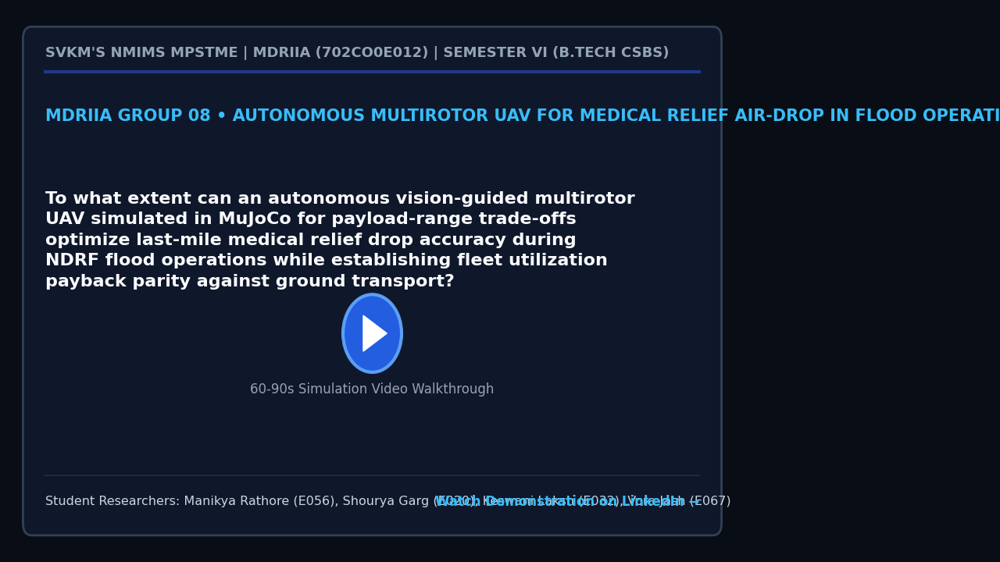

# SkyHydro

**A MuJoCo simulation for vision-guided UAV flood-relief delivery.**

SkyHydro studies a practical question: can a multirotor deliver a suspended medical payload more accurately in crosswind, and can a learned pilot complete a multi-stop flood-valley mission efficiently?

[Watch the project showcase](https://lnkd.in/p/dwu8AHcT) · [Read the technical dossier](docs/MDRIIA_Group_08_Technical_Dossier.pdf) · [Explore the implementation](#project-map)



> **Research prototype:** all flight and delivery results in this repository are simulated in MuJoCo. They are not evidence of real-world UAV performance or operational readiness.

## Highlights

- **Payload-aware delivery:** a downward camera measurement tracks the suspended canister relative to the target; the controller damps swing and waits for a stable release window.
- **Wind-stressed trials:** 240 seeded simulations compare a waypoint baseline and the proposed controller across 0, 5, 10, and 15 m/s crosswinds.
- **Multi-stop valley demo:** a PPO pilot trained in stages completes simulated four-house missions in the flood-valley scene.
- **Reproducible analysis:** per-run data, telemetry, statistical summaries, evaluation scripts, and trained model checkpoints are included.

## Results

### Drop-trial controller

Each condition contains 30 runs. “Success” means the canister landed in the target roof zone. At high wind, a conservative abort is counted separately from a delivery.

| Crosswind | Waypoint baseline | Vision-guided controller |
|---:|---:|---:|
| 0 m/s | 30/30 delivered | 30/30 delivered |
| 5 m/s | 30/30 delivered | 30/30 delivered |
| 10 m/s | 8/30 delivered | 23/30 delivered; 7 aborted safely |
| 15 m/s | 0/30 delivered; 19 missed into water, 11 not released | 17/30 delivered; 12 aborted safely, 1 landed outside the zone |

The proposed controller’s strongest practical difference is at 10–15 m/s: it uses canister-relative feedback and a release gate, reducing off-target releases while increasing delivery success in these simulated conditions. See the [trial data](analytics/flood_relief_real_trials.csv), [analysis](analytics/analyze_trials.py), and [summary statistics](analytics/trial_stats.json).

### Learned valley pilot

On 30 paired, same-seed four-house missions, both pilots completed all missions. The stage-3 PPO pilot averaged **150.2 s** per mission versus **309.0 s** for the scripted expert. The expert kept average canister swing lower (**2.3°** versus **8.9°**), so the learned policy trades steadier payload motion for faster missions in this evaluation.

See the [evaluation data](analytics/rl_pilot_real_trials.csv) and [results notes](results/README.md).

## Try it

### Requirements

- 64-bit Python 3.10–3.12
- MuJoCo and the Python packages in [requirements.txt](requirements.txt)
- A GPU is useful for training; viewing the included trained policy and replaying missions can run without training a new model.

### Install

**Windows**

```bat
setup_windows.bat
```

**Linux**

```bash
./setup_linux.sh
```

Or install dependencies in an existing Python environment:

```bash
python -m pip install -r requirements.txt
```

### Run a simulation

Watch the full flood-valley mission:

```bash
python simulate.py
```

Replay recorded missions:

```bash
python simulate.py --replay
```

Watch a single payload-drop trial:

```bash
python src/flood_relief_drop_sim.py --view
```

Compare the waypoint baseline in a 15 m/s crosswind:

```bash
python src/flood_relief_drop_sim.py --view --controller baseline --wind 15
```

Run the full controller experiment and regenerate its analyses:

```bash
python src/flood_relief_drop_sim.py --trials 30
python analytics/analyze_trials.py
python analytics/disaster_relief_logistics.py
```

The Monte Carlo experiment takes roughly 15–60 minutes, depending on the computer. To evaluate the trained pilot against the scripted expert:

```bash
python analytics/evaluate_rl_pilot.py --episodes 30
```

## Project map

| Path | Purpose |
|---|---|
| `src/flood_relief_drop_sim.py` | Drop mission, controllers, wind model, Monte Carlo runner, and telemetry |
| `models/skyhydro_flood_uav.xml` | MuJoCo UAV, rotors, suspended payload, winch, and target |
| `environment/`, `rl/`, `simulate.py` | Flood-valley scene, Gymnasium environment, pilot, and interactive viewer |
| `results/stage1-3/` | Trained policies, summaries, and mission replays |
| `analytics/` | Trial data, statistical analysis, and logistics model |
| `docs/` | Technical dossier, figures, and supporting research notes |

## Model scope and limitations

- Wind uses quadratic drag with first-order Gauss–Markov gusts; it is not a CFD model.
- The simulated downward camera provides a noisy target-relative measurement. The project does not implement image recognition from camera pixels.
- The valley demo’s survey scan is scripted and reads survivor counts from the scene; the learned pilot controls pickup and delivery missions.
- The logistics model is exploratory. Several inputs are assumptions, not measured costs; inspect the sensitivity analysis before drawing economic conclusions.
- Results depend on the simulator, controller, model parameters, and chosen test conditions. They do not establish safe or effective real-world performance.

## Project context

Built by MDRIIA Group 08 at NMIMS MPSTME as a 2026–27 robotics course project. The repository includes work by Manikya Rathore, Shourya Garg, Keswani Laksh, and Jash Vora.

For system design, assumptions, and detailed methodology, see the [technical dossier](docs/MDRIIA_Group_08_Technical_Dossier.pdf) and [research and implementation guide](RESEARCH_AND_IMPLEMENTATION_GUIDE.md).
